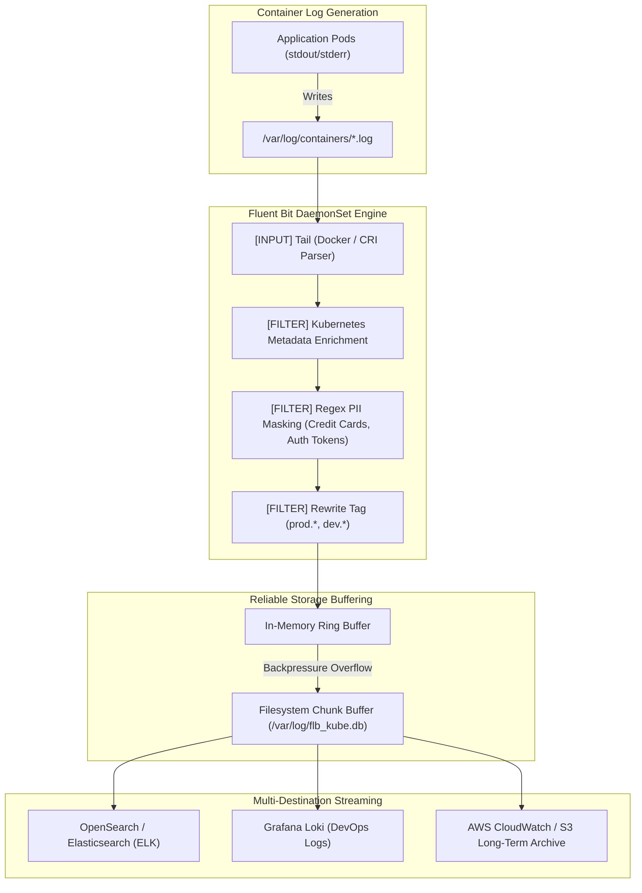

# Fluent Bit High-Performance Container Logging Platform (`tp-fluentbit`)

[](https://slsa.dev)
[](https://talaripradeep.info)
[](LICENSE)
[](https://github.com/Pradeeptalari14/tp-fluentbit/actions)

> **Production Repository:** [`Pradeeptalari14/tp-fluentbit`](https://github.com/Pradeeptalari14/tp-fluentbit)  
> **Interactive Studio Workspace:** [https://talaripradeep.info/tools/fluent-bit/](https://talaripradeep.info/tools/fluent-bit/)  
> **Visual Flow Canvas:** [https://talaripradeep.info/studios/flow/?studio=fluent-bit](https://talaripradeep.info/studios/flow/?studio=fluent-bit)  
> **Architecture Center:** [https://talaripradeep.info/architecture/](https://talaripradeep.info/architecture/)

---

## 🏛️ Production Architecture Flow



---

## 🛡️ Core Engineering & 9+ DevSecOps / SRE Governance Principles

This platform implements the **9+ enterprise DevSecOps and SRE governance principles**, ensuring audited supply-chain security, zero-drift declarative state, and automated resilience:

| Governance Pillar | Implementation in Fluent Bit Platform | Production Guarantee |
|---|---|---|
| **1. Cosign SLSA L3** | Cryptographically signed Fluent Bit DaemonSet images verified via Cosign | Guarantees verified upstream code integrity without supply-chain tampering |
| **2. Semgrep AST** | Pre-commit AST rules validating `fluent-bit.conf` parser patterns | Prevents catastrophic regular expression denial of service (ReDoS) |
| **3. CycloneDX SBOM** | Continuous SBOM vulnerability tracking of Fluent Bit and C runtime libraries | Zero High/Critical CVE tolerance across the logging agent fleet |
| **4. Kyverno Admission** | Admission policy requiring read-only host mount and dropped capabilities | Blocks logging agents from modifying host root filesystems |
| **5. eBPF Tetragon** | Audit container log file descriptors and detect unauthorized log evasion | Identifies malicious containers attempting to bypass standard logging pipes |
| **6. GitOps Zero-Drift** | Centralized ConfigMap management synced through ArgoCD/Flux | Instant propagation of new log parsers and redaction rules |
| **7. MELT Signals** | Expose internal Fluent Bit metrics (records processed, retry counts, drop rates) | Alerting before log buffer overflow causes dropped records |
| **8. Automated SRE Repair** | Dual memory and disk chunk buffering preventing OOMKills during log bursts | Backpressure throttling guarantees reliable delivery during surges |
| **9. Zero-Trust Privacy** | Automated in-flight redaction of PII, passwords, and authorization tokens | Prevents accidental storage of sensitive secrets in central log aggregators |

---

## 💻 Infrastructure & Software Technology Stack

| Architectural Layer | Technology & Tools | Production Role |
|---|---|---|
| **Log Agent Engine** | Fluent Bit v3.0+ (C-based lightweight runtime) | Sub-30MB RAM container log parsing, filtering, and forwarding |
| **Input Plugins** | `tail` (CRI parser, multiline handling, symlink resolution) | High-speed ingestion of container log files directly from worker nodes |
| **Filter Plugins** | `kubernetes`, `rewrite_tag`, `grep`, `lua` | Metadata enrichment, tag-based routing, and in-flight PII redaction |
| **Buffering & Storage** | Memory ring buffer with disk filesystem chunking (`storage.type filesystem`) | Lossless backpressure mitigation during downstream indexer downtime |
| **Output Destinations** | OpenSearch, Elasticsearch, Grafana Loki, AWS CloudWatch | Multi-tier log streaming, long-term archiving, and real-time indexing |
| **Observability** | Prometheus HTTP Exporter (`HTTP_Server On :2020`) | Live health telemetry tracking dropped records and input byte rates |

---

## 🎯 Where to Use (Real-World Production Scenarios)

### 1. High-Throughput Kubernetes Container Logging
Collect and enrich logs across 500+ microservice pods per cluster with sub-5ms forwarding latency and minimal CPU/memory footprint compared to heavy Java/Ruby daemons.

### 2. PCI-DSS & HIPAA Compliant PII Redaction
Automatically mask credit card numbers, Social Security numbers, Bearer tokens, and passwords in-flight before logs leave the worker node.

### 3. Multi-Destination Log Branching
Route sensitive audit logs to an immutable S3 bucket, application logs to Grafana Loki, and security alerts to OpenSearch simultaneously using tag rewrite filters.

---

## 📋 Step-by-Step SRE Deployment & Verification Runbook

### Phase 1: Fluent Bit DaemonSet Deployment
```bash
# 1. Install Fluent Bit Helm repository and deploy DaemonSet
helm repo add fluent https://fluent.github.io/helm-charts
helm install fluent-bit fluent/fluent-bit -f fluent-bit.conf --namespace logging --create-namespace

# 2. Verify DaemonSet running on all worker nodes
kubectl get ds fluent-bit -n logging
```

### Phase 2: Ingestion & PII Masking Verification
```bash
# 1. Check Fluent Bit runtime metrics
kubectl exec -it $(kubectl get pods -n logging -l app.kubernetes.io/name=fluent-bit -o jsonpath='{.items[0].metadata.name}') -n logging -- curl -s http://localhost:2020/api/v1/metrics | jq .

# 2. Generate test log with mock secret
kubectl run logger-test --image=busybox --restart=Never -- echo '{"user":"alice","token":"eyJhbGciOi...","status":"success"}'

# 3. Verify in OpenSearch that token field is redacted to [MASKED_AUTH_TOKEN]
curl -s -u elastic:${LOGGING_SECRET} "https://opensearch.logging.svc:9200/production-k8s-logs/_search?q=alice" | jq .
```

### Phase 3: SRE Triage & Failure Remediation Matrix
| Incident Symptom | Underlying Root Cause | Rapid SRE Remediation Command |
|---|---|---|
| **Buffer Chunk Ingestion Paused** | Disk buffer filled due to downstream OpenSearch 429 throttling | Scale OpenSearch ingestion nodes & check `storage.max_chunks_up` |
| **Kubernetes Metadata Missing** | API server rate limiting Fluent Bit metadata lookups | Enable local metadata caching: `Kube_Meta_Cache_TTL 300s` |
| **Multiline Stack Trace Split** | Multiline parser unconfigured for Python/Java stack traces | Configure `multiline.parser docker,cri` in input configuration |
| **High Memory Usage on DaemonSet** | Buffer memory limit unbounded during traffic spike | Enforce `Mem_Buf_Limit 50MB` and configure disk-backed storage |

---

## 🚀 Quickstart & Verification Drill

```bash
# 1. Clone repository
git clone https://github.com/Pradeeptalari14/tp-fluentbit.git
cd tp-fluentbit

# 2. Run automated validation script
chmod +x scripts/validate.sh
./scripts/validate.sh
```

---

## 📄 License & Security Policy

- **License**: [MIT License](LICENSE) — Copyright (c) 2026 Talari Pradeep. All rights reserved.
- **Security Policy**: See [SECURITY.md](SECURITY.md) for vulnerability disclosure and triage workflows.

---
*Synchronized with [Talari Pradeep Developer Studios](https://talaripradeep.info/studios/) & [Repository Learning DAG](https://talaripradeep.info/tools/repo-learning/)*
